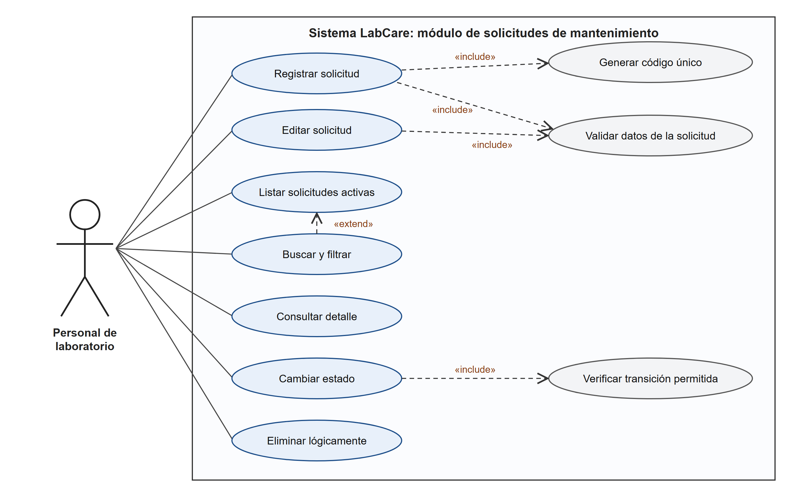
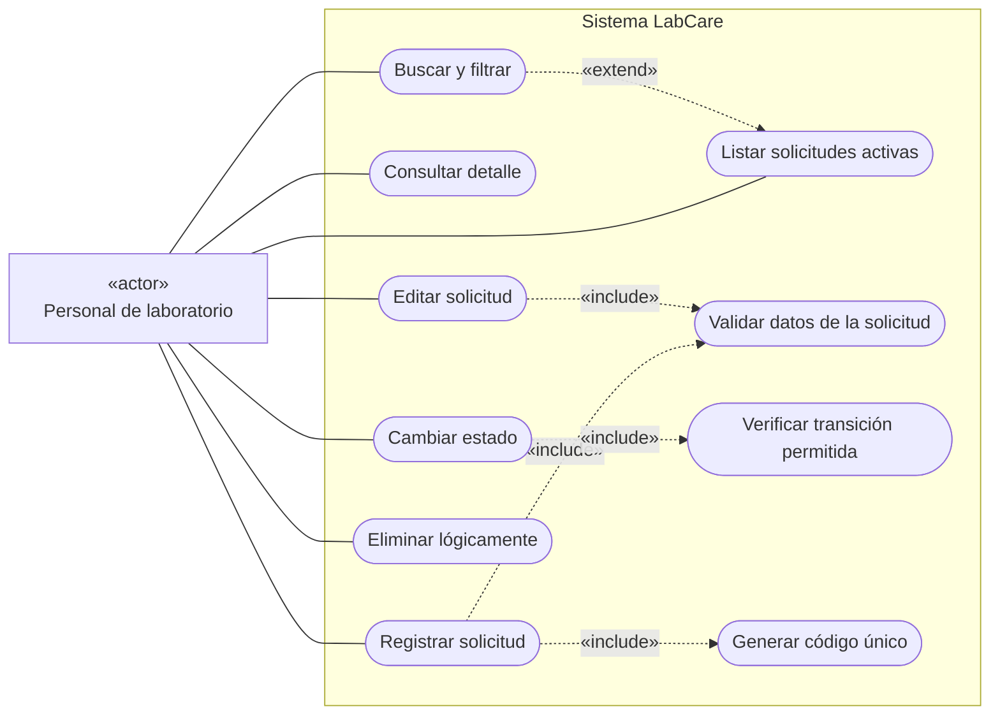
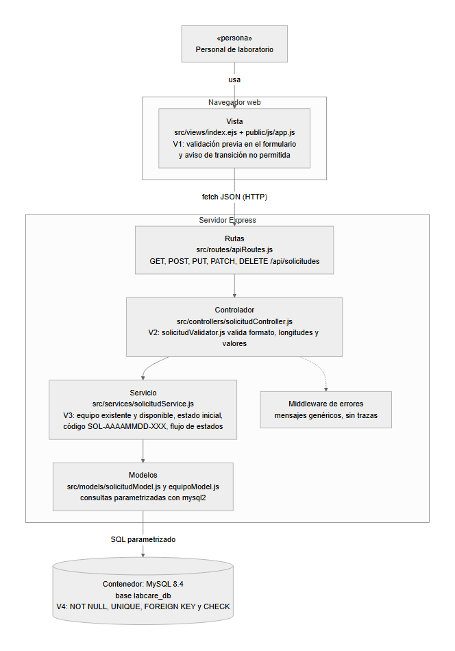
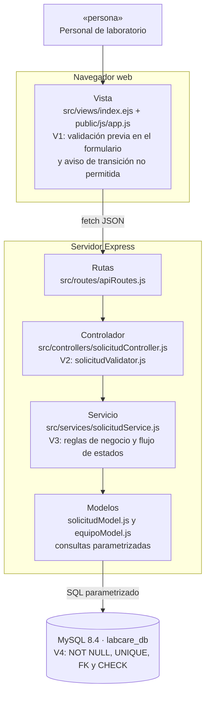
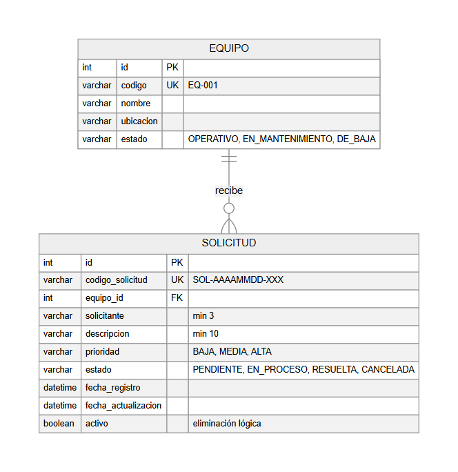

# Análisis del módulo de solicitudes de mantenimiento (LabCare)

## Problema y alcance

LabCare es una institución ficticia que administra laboratorios de computación. Hoy los reportes de fallas llegan por mensajes y hojas de cálculo, así que algunas solicitudes se pierden y nadie sabe con certeza en qué estado está cada una. El objetivo es un módulo web donde se registren, consulten, actualicen y controlen las solicitudes de mantenimiento, con los datos guardados en una base de datos.

El alcance de este examen es solo el módulo de solicitudes. El catálogo de equipos ya existe en la base de datos (se carga con los cuatro equipos semilla del enunciado) y la aplicación únicamente lo consulta para elegir el equipo de cada solicitud. Quedan fuera el inicio de sesión, la administración de usuarios y el mantenimiento del catálogo de equipos.

## Actores

El actor principal es el Personal de laboratorio, que reporta las fallas, revisa el listado, corrige los datos de una solicitud, actualiza su estado y elimina lógicamente las que ya no corresponden. El enunciado menciona también a los responsables de soporte; en esta versión usan la misma pantalla y las mismas acciones, porque no se implementan roles.

## Requerimientos funcionales

| ID | Requerimiento | Cómo se implementó |
|----|---------------|--------------------|
| RF-01 | Listar solicitudes activas con código, equipo, solicitante, prioridad, estado y fecha de registro. | `GET /api/solicitudes` y la tabla de la pantalla principal. |
| RF-02 | Registrar una solicitud eligiendo un equipo existente e ingresando solicitante, descripción y prioridad. | Formulario y `POST /api/solicitudes`. |
| RF-03 | Consultar una solicitud por su identificador con todos sus datos. | Botón Ver y `GET /api/solicitudes/:id`. |
| RF-04 | Editar los datos descriptivos de una solicitud. | Botón Editar y `PUT /api/solicitudes/:id`. |
| RF-05 | Cambiar el estado respetando el flujo permitido. | Botón Estado y `PATCH /api/solicitudes/:id/estado`. |
| RF-06 | Eliminación lógica: la solicitud deja de listarse pero sigue en la base. | Botón Eliminar con confirmación y `DELETE /api/solicitudes/:id`, que hace `activo = FALSE`. |
| RF-07 | Buscar por código de solicitud, solicitante o nombre del equipo. | Campo Buscar, parámetro `q`. |
| RF-08 | Filtrar por prioridad y estado. | Listas de filtro, parámetros `prioridad` y `estado`. |
| RF-09 | Mostrar mensajes claros de éxito, validación y error. | Barra de mensajes y errores por campo. |
| RF-10 | Mantener los datos al cerrar o recargar la aplicación. | Todo se guarda en MySQL. |

## Reglas de negocio

| Regla | Dónde se valida |
|-------|-----------------|
| El equipo debe existir y estar disponible. Consideramos disponible a un equipo OPERATIVO o EN_MANTENIMIENTO; uno DE_BAJA no se puede elegir. | Servicio (`validarEquipo`) y clave foránea en MySQL. |
| Solicitante obligatorio, mínimo 3 caracteres después de quitar los espacios externos. | Validador del backend, formulario y `CHECK` en MySQL. |
| Descripción obligatoria, mínimo 10 caracteres después de quitar los espacios externos. | Validador del backend, formulario y `CHECK` en MySQL. |
| Prioridad solo BAJA, MEDIA o ALTA. | Validador del backend y `CHECK` en MySQL. |
| Toda solicitud nueva empieza en PENDIENTE. | El `INSERT` del modelo fija el estado; el cliente no lo puede elegir. |
| Código automático y único con formato SOL-AAAAMMDD-XXX. | Servicio (`registrar`) y `UNIQUE` en MySQL. Si dos registros chocan, se reintenta con el siguiente correlativo. |
| PENDIENTE puede pasar a EN_PROCESO o CANCELADA. | Servicio (`TRANSICIONES`). |
| EN_PROCESO puede pasar a RESUELTA o CANCELADA. | Servicio (`TRANSICIONES`). |
| RESUELTA y CANCELADA son finales: no vuelven a PENDIENTE ni a EN_PROCESO. | Servicio; responde 409. |
| La edición no cambia el id, el código, el estado ni la fecha de registro. | El `UPDATE` del modelo solo toca equipo, solicitante, descripción y prioridad. |
| Una solicitud en estado final ya no se edita. Es una decisión nuestra para que no cambie la información de un trabajo cerrado. | Servicio; responde 409. |
| Eliminación lógica: no hay `DELETE` físico, se pone `activo = FALSE` y se excluye del listado. | Modelo (`desactivar`). |

Las validaciones de la interfaz solo ayudan al usuario a corregir antes de enviar. El servidor vuelve a validar todo, y la base de datos tiene sus propias restricciones como última barrera.

## Diagrama de casos de uso

## Arquitectura (C4 de contenedores con capas MVC)

La aplicación es un solo contenedor Node.js con Express que sirve la vista y la API REST, más un contenedor MySQL. Dentro de la aplicación separamos rutas, controlador, servicio y modelos. Las marcas V1 a V4 indican dónde se ejecutan las validaciones.

## Modelo de datos

La relación es de uno a muchos: un equipo puede tener muchas solicitudes y cada solicitud pertenece a un solo equipo. La clave foránea usa `ON DELETE RESTRICT`, así que no se puede borrar un equipo que tenga solicitudes y nunca quedan solicitudes huérfanas. El script completo está en `database/labcare.sql`.
